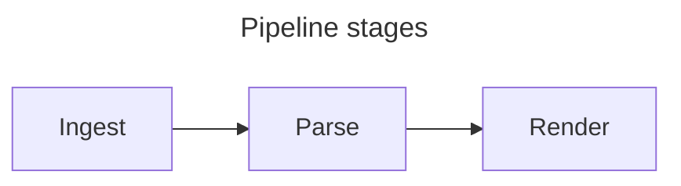
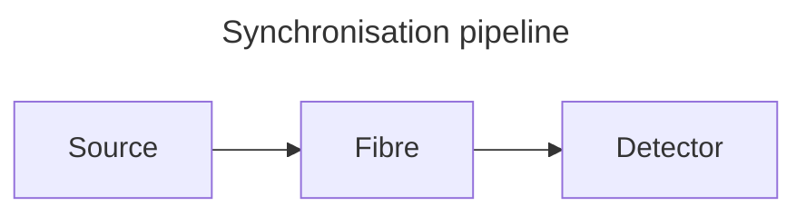

# Writing documents for Halmos

Halmos reads ordinary Markdown. It has no format of its own — citations follow
Pandoc, maths follows KaTeX, charts are Vega-Lite and diagrams are Mermaid, so
a document written for Halmos stays readable in other tools.

What follows is the part that is *not* guessable: which conventions Halmos
acts on, and the handful of things that silently do nothing.

This file is written to be pasted whole into an AI assistant as instructions
for producing a Halmos document.

---

## Frontmatter: exactly ten keys

```markdown
---
title: Yield response of winter wheat to late nitrogen
author:
  - name: Ada Lovelace
    affiliation: University of London
  - name: Charles Babbage
    affiliation: University of Cambridge
  - Mary Somerville
date: 26 October 2026
abstract: |
  Late nitrogen raised yield by 8% across three seasons ($p < 0.01$).
  The response was largest on light soils.
bibliography: references.bib
csl: apa
toc: true
toc-depth: 3
---
```

`title`, `author`, `date`, `abstract`, `bibliography`, `csl`, `toc`,
`toc-depth`, `header` and `footer` are the **only** keys Halmos reads. All are optional. The bibliography path is
resolved relative to the document, so the `.bib` normally sits beside it;
`toc` and `toc-depth` are described under
[A table of contents](#a-table-of-contents) below. `header` and `footer` are
one line of text drawn at the top and bottom of every page of an exported
PDF, and may use `{title}` (the `title:` key, or the first heading if there is none),
`{date}` (the export date, not the `date:` key), `{page}` and `{pages}`:
`footer: Page {page} of {pages}`. When the document has a title block, the
header is left off page 1, where the title already shows; the footer is not.

`title`, `author`, `date` and `abstract` are Pandoc's names, and make a title
block at the top of the preview, the PDF and the HTML export. Word and LaTeX
get the same block from Pandoc. Each is optional, and the block shows only
the ones you set. File → New… with *Start from: Research article* fills in
`title`, `author` and `abstract` for you; add a `date:` line yourself when
you want one.

- `title` is one line. Emphasis and inline maths work. A citation in it is
  shown as you typed it, not formatted.
- `author` is one name (`author: Ada Lovelace`), a list of names, or a list
  of entries with a `name` and an optional `affiliation`, as in the example.
  A single `name:` entry also works. You can mix names and entries. Each
  different affiliation is numbered in order of first use; if everyone shares
  one, it is shown once under the names. In Word and LaTeX an author with an
  affiliation is sent as "Name, Affiliation".
- `date` is shown exactly as written. Halmos does not read or change it.
- `abstract` is Markdown, normally a block written with `|` as above. Maths
  and citations work. Footnotes in it are listed under the abstract, not
  with the body's. A heading in it does not appear in the contents list.

The title and abstract are spell checked. If the YAML in the frontmatter is
broken, or a key has a shape Halmos does not read, the title block is left
out and the document still renders. Word and LaTeX exports may then get no
title block either.

Put quotes around any value that contains a colon followed by a space, or that
starts with `{`, `[` or a quote mark. `title: Yield: a study` is not valid
YAML and the whole title block disappears; `title: "Yield: a study"` works.
The same goes for a `header` or `footer` that starts with `{`:
`header: "{title} - draft"`.

`csl` is one of five bundled styles — `apa`, `chicago-author-date`,
`ieee`, `vancouver`, `harvard` — or the path to a `.csl` file, relative to the
document or absolute. A name Halmos does not know, or a file it cannot load,
falls back to APA with a warning. You do not have to type this line: use
Format → Citation Style (see [Citations](#citations)).

**The frontmatter block is removed before rendering**, and the title block
is built from it. If you also write a `# Title` heading in the document, the
title shows twice: use one or the other. A document with no `title:` can
still start with a heading, as before:

```markdown
# Entanglement-verified time distribution

Craig Richards
```

## Citations

Cite by the BibTeX key. Bracketed citations are parenthetical:

```markdown
Photon pairs decohere over distance [@alqedra2026].
Two sources agree [@alqedra2026; @bennett2019].
As shown elsewhere [see @alqedra2026, p. 31].
Only the year is needed [-@alqedra2026].
```

- Separate multiple keys with `;`
- Text before the `@` becomes a prefix (`see`, `cf.`)
- A trailing `, p. 31`, `, pp. 31-34`, `, chapter 3` or `, sec. 2` is parsed as
  a locator; other trailing text becomes a suffix
- A `-` immediately before the `@` suppresses the author

A bare `@key` outside brackets is a narrative citation, for naming the author
in your own sentence:

```markdown
@alqedra2026 measured a fidelity of 0.817.
```

The bibliography is generated automatically at the end of the document under a
"References" heading. Do not write one by hand.

### Autocomplete

With a `bibliography:` set, typing `[@`, `; @`, `-@` or a bare `@` opens a list
of entries from the `.bib`: key, author and year, and title. Keep typing to
narrow it; Return inserts the key. The list shows up to 100 entries at a time.
There is no list when the document names no bibliography, and none inside code,
maths or frontmatter.

### Hover and unknown citations

Hover over a citation key in the editor to see the formatted reference in the
document's style. If the key is not in the `.bib`, the hover says `Not in <bib name>`.

Keys that are not in the `.bib` get a red wavy underline. The status bar shows
"N unknown citations"; click it to see the list with line numbers, and click a
line to jump to it. Check this before you submit.

### Choosing a style

Format → Citation Style lists APA, Chicago (author-date), Harvard, IEEE and
Vancouver. The current one is ticked. Choosing one rewrites the `csl:` line in
the frontmatter.

Other Style File… opens a `.csl` file from disk. If the file is inside the
document's folder, `csl:` holds a path relative to the document; otherwise it
holds the absolute path. A document that has not been saved yet has no folder,
so save it first. Halmos does not watch the style file: after editing it,
reopen the document or choose the style again.

## Footnotes

```markdown
The result held in every run.[^1] Some runs were repeated.^[Three times each.]

[^1]: Run 4 was discarded after a laser fault [@alqedra2026].
```

- `[^1]` marks the spot; `[^1]: text` defines the note. The definition can sit
  anywhere in the document.
- `^[text]` is an inline note with no separate definition.
- Notes are numbered in the order they are cited and listed after the
  References.
- Citations inside a footnote are formatted like any other.

## Maths

KaTeX, inline with `$…$` and displayed with `$$…$$`:

```markdown
The fidelity $F = \langle\Phi^+|\rho|\Phi^+\rangle$ exceeded the classical bound.

$$
C(\rho) = \max(0, \lambda_1 - \lambda_2 - \lambda_3 - \lambda_4)
$$
```

A malformed expression renders in red rather than breaking the document. `$5`
and other prices are left alone.

## Figures: a caption is what makes a figure

A block with a caption becomes a numbered `<figure>`. A block without one
renders plainly. Charts, images and diagrams share **one** numbering sequence,
in document order.

Captions are never written as a separate paragraph. Each format carries its
own, which is what keeps them through a Pandoc conversion:

| Block | Where the caption comes from |
|---|---|
| Image | the alt text — `` |
| Vega-Lite chart | the spec's `title` |
| Mermaid diagram | a `title:` in the diagram's own frontmatter |

An image with empty alt text (``) stays decorative and is not
numbered — use that for rules and spacers.

Image paths resolve **relative to the document**, the same way `bibliography:`
does, so a figure stored beside the file is just its filename. `../shared/`
and absolute paths work too. A remote URL works as well.

A local image needs an image file extension: `.png`, `.jpg`/`.jpeg`, `.gif`,
`.webp`, `.svg`, `.avif`, `.bmp`, `.tif`/`.tiff`, `.heic`/`.heif`, `.apng`,
`.jfif`, `.ico`, `.jxl`, or `.pdf` for a PDF figure. Any other file beside
the document is not shown, so a document cannot display a file you did not
mean to put in it.

```markdown


```

A document that has never been saved has no folder to resolve against, so save
it before referring to a local image.

Captions read "Figure 1: Caption", with a colon.

Do not write "Figure 1" in prose. Halmos numbers the figure itself, and a
number typed by hand is wrong as soon as a figure is inserted above it. To
refer to a figure, use a reference; see "Referring to figures, tables and
equations" below.

Only top-level blocks are numbered. A chart or diagram inside a list item or a
blockquote still renders, but takes no figure number.

## Tables

GFM pipe tables render as tables. Insert → Table… opens a grid: type into the
cells, add or remove rows and columns, set a column's alignment, or paste
comma- or tab-separated text under Import. Insert writes a padded table at
the cursor; with the cursor inside an existing table the same command opens
it for editing and Update replaces it. Cells hold ordinary markdown, so
`**bold**`, links and `[@citations]` work inside them.

| Sample  | n   | Mean |
| :------ | --: | ---: |
| Control | 12  | 4.1  |
| Treated | 11  | 6.3  |

### Table captions

A caption makes a table a numbered table. Leave one blank line after the
table, then write the caption on a line that starts with a colon:

```markdown
| Sample  | n   | Mean |
| :------ | --: | ---: |
| Control | 12  | 4.1  |

: Results by group
```

This renders as "Table 1: Results by group", above the table. Tables are
numbered in document order, separately from figures. A table without a
caption is not numbered. The Table… builder has a Caption field, and it
will not clear the caption of a table that has a label (see below).

## Referring to figures, tables and equations

A reference shows the number of a figure, table or equation and links to it.
It renumbers itself when something is inserted above.

**Give the target a label.** The label is a name in braces, written with
the target:

| Target | Where the label goes |
|---|---|
| Image | after the image: `{#fig:recovered}` |
| Chart | on the opening fence line: ` ```vega-lite {#fig:fidelity} ` |
| Diagram | on the opening fence line: ` ```mermaid {#fig:pipeline} ` |
| Table | at the end of the caption line: `: Results by group {#tbl:results}` |
| Display equation | after the closing `$$`: `$$ … $$ {#eq:bayes}` |

An image's label must touch the `)`, with no space before the brace. With a
space, Pandoc does not read it as a label, so Halmos shows the braces as text
and the image is not a figure.

Each label names one target. If two targets share a label, references go to
the first one, and the second is listed with the missing references (see
below).

Targets inside a list item or a blockquote are not numbered, even with a
label, so a reference to one shows "Figure ??". Halmos does not show the
label, and Word export leaves those targets unnumbered too.

You seldom type a label. When you pick a figure or table that has none,
Halmos writes one made from its caption, such as `fig:yield-by-variety`
(with `-2` added if that name is taken). When you pick an equation, Halmos
asks for a short name and writes `eq:` plus that name. The label stays the
same if you reword the caption later.

**Write the reference.** Use `@` and the label:

```markdown
As @fig:recovered shows, the yield fell. See @tbl:results and @eq:bayes.
Both curves agree [@fig:recovered; @fig:fidelity].
```

These render as "Figure 1", "Table 1" and "Equation 1". The grouped form
renders "Figures 1, 2". Write `@Fig:recovered` for a capital letter at the
start of a sentence.

**Pick instead of typing.**

- Type `@fig:`, `@tbl:` or `@eq:` to get a list of that kind, with each
  number and caption. Equations show the formula.
- Choose Insert → Cross-reference… (⇧⌘R) to list all kinds together. If
  there is nothing to refer to, it says so.

Only top-level figures and tables that have a caption are listed, and
top-level display equations. A reference written on the target's own line
is refused with a message.

**Equation numbers.** A display equation is numbered only once it has a
label, and the number shows at the right as "(1)". Equations you never refer
to stay unnumbered.

**Things to know.**

- `@fig` with no colon is still a citation, so a key such as `figueroa2019`
  works as before.
- A reference to a label that does not exist shows "Figure ??". The status
  bar counts them ("2 missing cross-references"); click it for a list that
  jumps to each. A label used by two targets is counted there too, and
  listed as "used twice" at the second one.
- Bibliography keys that start `fig:`, `tbl:`, `eq:` or `sec:` cannot be
  cited, because those prefixes mean a reference. Halmos names any such key
  when the bibliography loads. Rename the key in the `.bib` file.
- References to sections are not supported yet. `@sec:` shows "Section ??".
- In LaTeX export, charts and diagrams stay as code, so a reference to one
  shows as missing there. Word export numbers them as the preview does.

## A table of contents

Set `toc: true` in the frontmatter and the document gets a contents page:
every heading is a link that works in the preview and in the exported PDF.
By default the contents sit at the top and list headings down to level
three; `toc-depth: 2` (1–6) changes the cut-off.

To put a title page or an introduction before the contents, write a
paragraph containing exactly `[[toc]]` where the contents belong. Only
headings *after* that point are listed — a title above it stays out of its
own contents page — though every heading still gets an anchor, so
`[see the appendix](#appendix)` works anywhere in the document.

## Charts

A `vega-lite` fenced block holding a Vega-Lite JSON spec. The data goes in
the spec, as `values` (rows, or CSV/TSV text with a `format`). A chart does
not load anything from a URL or a file, which keeps the document
self-contained and stops a chart someone sent you from reading or sending
anything:

````markdown
```vega-lite
{
  "title": "Recovered sources by condition",
  "data": {"values": [
    {"dose": 0, "response": 1.5},
    {"dose": 5, "response": 3.25}
  ]},
  "mark": "line",
  "encoding": {
    "x": {"field": "dose", "type": "quantitative"},
    "y": {"field": "response", "type": "quantitative"}
  }
}
```
````

The `title` becomes the figure caption and is not drawn inside the chart.

Width and figure alignment are application settings, not document ones — do
not set `width` unless a particular chart genuinely needs to override the
document default.

A chart stays editable in the graphical builder only if it uses a single
`mark` with `x`, `y` and optional `color` encodings. Styling the builder has no
control for is kept as written when the chart is reopened: `axis`, `scale`,
`legend` and `sort` on an encoding, settings on the mark such as `point`,
`opacity` or `interpolate`, and a top-level `config`. Styling is written for one
chart, so the builder lets it go as the chart changes: a new chart type drops
all of it, a new column or type drops that axis's, new data drops `scale` and
`sort`, and editing an axis title drops the `axis` title it would otherwise
lose to. `layer`, `transform`, `facet`, `timeUnit` and `bin` (outside a
histogram) render fine but cannot be reopened there; the builder says which
one it found.

## Diagrams

A `mermaid` fenced block. Any diagram type Mermaid supports works — flowchart,
sequence, state, class, ER, gantt, pie.

````markdown

````

The `title:` in the diagram's frontmatter becomes the figure caption. Omit it
for an unnumbered diagram.

## Code

Fenced blocks are syntax highlighted in both panes. The language tag must be
one the highlighter recognises, or the block renders plain — `python`, `r`,
`julia`, `fortran`, `c++`, `javascript`, `go`, `rust`, `shell`, `sql`, `json`,
`yaml` and `latex` are all safe.

````markdown
```python
def concurrence(rho):
    return max(0, eigenvalues(rho)[0] - sum(eigenvalues(rho)[1:]))
```
````

## Task lists

A list item that starts with `[ ]` or `[x]` is a task. The preview and the PDF
show a read-only checkbox, ticked for `[x]`.

```markdown
- [x] Write the introduction
- [ ] Add the second figure
```

## Alerts

A blockquote whose first line is only `[!NOTE]`, `[!TIP]`, `[!IMPORTANT]`,
`[!WARNING]` or `[!CAUTION]` becomes a coloured box with that title. The marker
is not case-sensitive, and nothing else may share its line.

```markdown
> [!WARNING]
> The measurement window is only valid for the first 10 ms.
```

## What does not work

- **Raw HTML.** It is escaped and appears as literal text. No `<br>`, no
  `<div align="center">`, no `<sub>`. Use Markdown, or maths for subscripts.
- **A hand-written References section.** It is generated.
- **`title:` or `author:` in frontmatter.** Silently dropped.
- **Figure and table numbers written by hand.** They are generated. Use a
  reference instead.
- **Cross-references to charts and diagrams in LaTeX.** See above.

## A complete example

````markdown
---
bibliography: references.bib
csl: apa
---

# Entanglement-verified time distribution

## Introduction

Distributing entangled photon pairs across a metropolitan fibre network
synchronises distant clocks to tens of picoseconds [@alqedra2026].
@bennett2019 first proposed the approach.

The concurrence is bounded below by

$$
C(\rho) = \max(0, \lambda_1 - \lambda_2 - \lambda_3 - \lambda_4)
$$

## Method



## Results

```vega-lite
{
  "title": "Fidelity against fibre length",
  "data": {"values": [
    {"km": 0, "fidelity": 0.94},
    {"km": 10, "fidelity": 0.86},
    {"km": 20, "fidelity": 0.82}
  ]},
  "mark": "line",
  "encoding": {
    "x": {"field": "km", "type": "quantitative"},
    "y": {"field": "fidelity", "type": "quantitative"}
  }
}
```

Fidelity fell with distance, remaining above the classical bound throughout.
````

That document produces two numbered figures — "Figure 1: Synchronisation
pipeline" and "Figure 2: Fidelity against fibre length" — two resolved
citations, a display equation, and a generated reference list.
