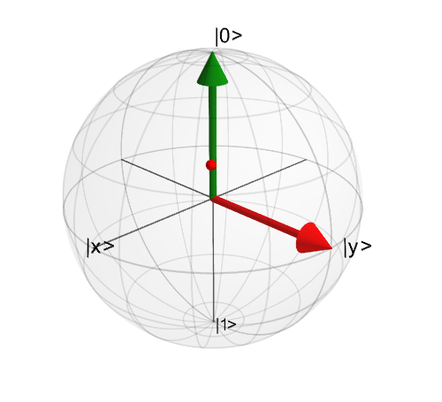
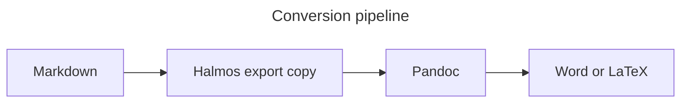

Each section opens with a **Check:** line saying what the Word (`.docx`) and
LaTeX (`.tex`) output should show. Export this file to PDF, Word and LaTeX,
and compare. The style is IEEE, so citations are numbered in reading order.

## 1. Title block

**Check:**
- **Title:** shown once, with its colon kept.
- **Authors:** all three appear. In Word and LaTeX, the first two read
  "Ada Lovelace, University of London" and "Charles Babbage, University of
  Cambridge", and the third reads "Mary Somerville".
- **Date:** "27 October 2026", exactly as written.
- **Abstract:**
  - It shows its italic word and its formula.
  - Its citation is [1], the first number in the document.
  - Its reference reads "Figure 1".
- **PDF:** no header on page 1. From page 2, the title is at the top of each
  page, and "Page N of M" is at the bottom of every page.
- **Word and LaTeX:** no stray `{title}` or "Page {page}" text anywhere.

## 2. Text

**Check:**
- Bold, italic, strike-through, inline code and the link all survive.
- Both footnotes are numbered and listed at the end (Word) or at the foot of
  the page (LaTeX).

This line has **bold**, *italic*, ~~struck~~ and `inline code`, and a
[link to Pandoc](https://pandoc.org). A first footnote[^one] and a
second[^two].

> A block quotation, which should be indented in every format.

[^one]: The first note, with a formula $a^2 + b^2 = c^2$.
[^two]: The second note, citing [@bandiComprehensiveOverviewAtomic2023].

## 3. Lists

**Check:**
- **Nesting:** both lists keep their nesting.
- **Numbering:** the numbered list counts 1, 2, 3.
- **Task list:** shows ticked and empty boxes, or plain bullets, but never
  `[ ]` as text.

- First point
  - Nested point
  - Another nested point
- Second point

1. Step one
2. Step two
   1. Sub-step
3. Step three

- [x] A finished task
- [ ] An open task

## 4. Citations

**Check:**
- Every form below formats in IEEE style.
- Numbers continue from the abstract's [1].
- The unknown key shows as "(nosuch2099?)" in Word and LaTeX, as Pandoc does.
- **Reference list:** comes after the text under a "References" heading that
  Halmos adds, so the document doesn't write one. It's in IEEE order and
  leaves out the unknown key.

- One source [@brackerFineStructureOptical2008].
- Two at once [@branczykHongOuMandelInterference2024; @coishNuclearSpinsNanostructures2009].
- Narrative: @DecoherenceQuantumToClassicalTransition2007 shows this.
- With a page: [see @bandiComprehensiveOverviewAtomic2023, p. 3].
- Year only: [-@feinQuantumSuperpositionMolecules2019].
- Unknown key: [@nosuch2099].

## 5. Figures

**Check:**
- **Numbering:** the figures are numbered 1, 2, 3, 4 in this order in every
  format, with captions such as "Figure 1: …".
- **Images:** the decorative image has no number and no caption.
- **Charts and diagrams:**
  - Word: the chart and the diagram are pictures.
  - LaTeX: they stay as code, so they are not figures there. This is known.

A labelled image:

{#fig:photo}

An unlabelled captioned image. Halmos gives it a hidden label for export, so
it is still numbered:


A decorative image, with no alt text:


A labelled chart:

```vega-lite {#fig:chart}
{
  "title": "Recovered sources by category",
  "data": {"values": [
    {"category": "A", "value": 12}, {"category": "B", "value": 27},
    {"category": "C", "value": 19}
  ]},
  "mark": "bar",
  "encoding": {
    "x": {"field": "category", "type": "nominal"},
    "y": {"field": "value", "type": "quantitative"}
  }
}
```

A labelled diagram:



## 6. Tables

**Check:**
- **Numbering:** the two captioned tables are numbered 1 and 2, apart from
  the figures.
- **Captions:** each caption reads "Table N: …", above its table.
- **Uncaptioned table:** it has no number.
- **Alignment:** right-aligned columns stay right-aligned.

| Group     | Yield (t/ha) | Change |
| --------- | -----------: | -----: |
| Control   |         6.12 |      — |
| Late N    |         6.61 |    +8% |
| Split N   |         6.48 |    +6% |

: Yield by treatment {#tbl:yield}

| Season | Rainfall (mm) |
| ------ | ------------: |
| 2024   |           512 |
| 2025   |           438 |

: Rainfall by season, with no label

| An | uncaptioned | table |
| -- | ----------- | ----- |
| 1  | 2           | 3     |

## 7. Equations

**Check:**
- **Labelled equation:** shows the number (1) at the right.
- **Unlabelled display equation:** has no number.
- **Inline maths:** stays in the line.

A labelled equation:

$$ E = mc^2 $$ {#eq:energy}

An unlabelled display equation, not numbered:

$$
\int_0^\infty e^{-x^2}\,dx = \frac{\sqrt{\pi}}{2}
$$

Inline: the mean is $\bar{x} = \tfrac{1}{n}\sum_i x_i$.

## 8. Cross-references

**Check:**
- **Word:** each reference is linked text, for example "Figure 1" or
  "Table 1".
- **LaTeX:** the references to the photograph, the table and the equation
  resolve. The ones to the chart and the diagram do not, which is known.
- **Missing label:** the reference to it is visibly broken in every format.

- The labelled photograph: @fig:photo.
- At the start of a sentence: @Fig:chart shows the categories.
- Two at once: [@fig:photo; @fig:pipeline].
- The table: @tbl:yield.
- The equation: @eq:energy.
- A missing label: @fig:nosuch.

## 9. Code

**Check:**
- The block keeps its line breaks and indentation, in a fixed-width font.
- Word may colour the syntax; LaTeX may not.

```python
def mean(xs):
    """The arithmetic mean."""
    return sum(xs) / len(xs)
```

## 10. Alerts

**Check:**
- GitHub-style alerts have no Pandoc equivalent. Expect a block quotation
  that starts with "[!NOTE]" or "Note". Record which one you get.

> [!NOTE]
> An alert, for comparison with the preview.
